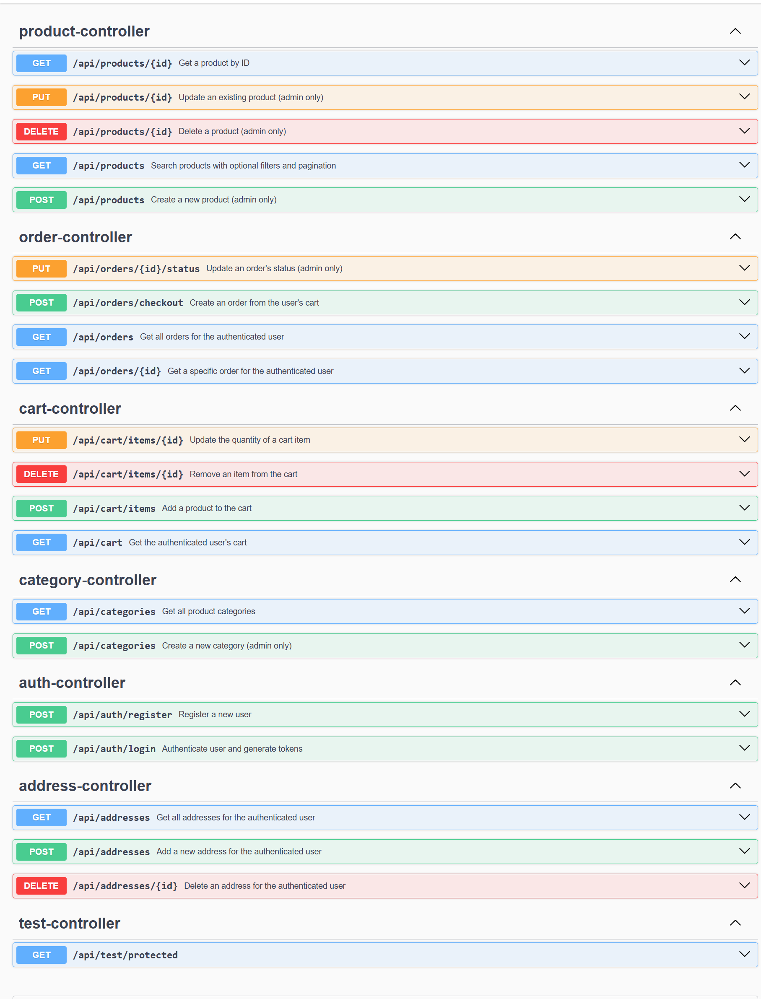

# E-commerce Backend

A production-oriented REST API for an e-commerce platform, built with **Spring Boot 4**, **MySQL 8**, and **Docker**. It covers JWT authentication with refresh-token rotation, Google OAuth login, role-based access, a product catalog with filtering and pagination, carts, addresses, and a transactional checkout with price snapshotting.


---

## Table of Contents

- [Features](#features)
- [Architecture](#architecture)
- [Tech Stack](#tech-stack)
- [API Endpoints](#api-endpoints)
- [Authentication Design](#authentication-design)
- [Business Rules](#business-rules)
- [Database](#database)
- [Project Structure](#project-structure)
- [Getting Started](#getting-started)
- [Environment Variables](#environment-variables)
- [Testing](#testing)
- [API Documentation](#api-documentation)
- [Screenshots](#screenshots)
- [License](#license)

---

## Features

**Authentication and security**
- Register, login, refresh, and logout
- JWT access tokens (15 min) and refresh tokens (7 days)
- Refresh-token rotation: each token is single-use, stored as a SHA-256 hash, and revoked on logout
- Google OAuth 2.0 login
- Role-based authorization (`USER`, `ADMIN`)
- Stateless sessions, BCrypt password hashing
- Custom JSON handlers for `401 Unauthorized` and `403 Forbidden`

**Commerce**
- Product and category management (categories support a parent/child hierarchy)
- Product filtering by category and price range, with pagination and sorting (JPA Specifications)
- Shopping cart management
- Address management with ownership checks
- Transactional checkout and order history
- Admin order status management with a validated state machine
- Price snapshotting in order items

**Engineering**
- Validated request DTOs and response DTOs (no entities in API responses)
- Global exception handling with consistent HTTP status mapping
- Request/response logging filter
- Flyway database migrations with `ddl-auto: validate`
- Unit tests (JUnit, Mockito) and integration tests (Testcontainers)
- Dockerized with a multi-stage Dockerfile and Docker Compose
- Swagger / OpenAPI documentation

---

## Architecture

```mermaid
flowchart TD
    A[Client] --> B[LoggingFilter]
    B --> C[JwtAuthenticationFilter]
    C --> D[Spring Security rules]
    D --> E[Controller<br/>validated request DTOs]
    E --> F[Service<br/>@Transactional business rules]
    F --> G[Repository<br/>Spring Data JPA]
    G --> H[(MySQL 8<br/>Flyway migrations)]
    F --> I[Mapper]
    I --> J[Response DTO]
```

---

## Tech Stack

| Layer | Technology |
|---|---|
| Language | Java 21 |
| Framework | Spring Boot 4.1, Spring Framework 7 |
| Security | Spring Security 7, JJWT 0.12.6 (HS512), OAuth 2.0 (Google) |
| Persistence | Spring Data JPA, Hibernate 7, MySQL 8.0 |
| Migrations | Flyway |
| JSON | Jackson 3 |
| API docs | springdoc-openapi (Swagger UI) |
| Testing | JUnit 6, Mockito, Testcontainers |
| Build | Maven |
| Deployment | Docker, Docker Compose |
| Other | Lombok |

---

## API Endpoints

### Public

| Method | Path | Description |
|---|---|---|
| POST | `/api/auth/register` | Create an account |
| POST | `/api/auth/login` | Get access and refresh tokens |
| POST | `/api/auth/refresh` | Rotate the refresh token, get a new pair |
| POST | `/api/auth/logout` | Revoke the refresh token |
| GET | `/oauth2/authorization/google` | Start Google login (open in a browser) |
| GET | `/api/products` | List products (filter, paginate, sort) |
| GET | `/api/products/{id}` | Get one product |
| GET | `/api/categories` | List categories |

### Authenticated (USER or ADMIN)

| Method | Path | Description |
|---|---|---|
| GET | `/api/cart` | View your cart |
| POST | `/api/cart/items` | Add an item |
| PUT | `/api/cart/items/{id}` | Update item quantity |
| DELETE | `/api/cart/items/{id}` | Remove an item |
| GET / POST / PUT / DELETE | `/api/addresses/**` | Manage your addresses |
| POST | `/api/orders/checkout` | Place an order from your cart (`{ "addressId": ... }`) |
| GET | `/api/orders` | Your order history |
| GET | `/api/orders/{id}` | One of your orders |

### ADMIN only

| Method | Path | Description |
|---|---|---|
| POST | `/api/products` | Create a product |
| PUT | `/api/products/{id}` | Update a product |
| DELETE | `/api/products/{id}` | Delete a product |
| POST | `/api/categories` | Create a category |
| PUT | `/api/orders/{id}/status` | Change an order's status |

**Product query parameters:** `categoryId`, `minPrice`, `maxPrice`, `page`, `size`, `sort`

Example: `GET /api/products?categoryId=2&minPrice=100&maxPrice=5000&page=0&size=10&sort=price,asc`

---

## Authentication Design

```
Login / Register / Google OAuth
            |
            v
   AuthService.issueTokens(user)
            |
   +--------+---------+
   |                  |
Access token       Refresh token
(JWT, 15 min)      (random jti, 7 days)
                   stored as SHA-256 hash
```

- **Access token:** short-lived JWT sent as `Authorization: Bearer <token>`.
- **Refresh token:** rotated on every use. The old one is revoked immediately, and logout revokes the current one.
- **Trade-off:** an access token stays valid until it expires, even after logout. This is the standard cost of stateless JWTs.
- **Google login:** the user is found or created with provider `GOOGLE`, then receives the same token pair as a local login.
- **Admins** are created by updating the `role` column directly in the database.

---

## Business Rules

### Checkout

`OrderService.checkout` runs in a single transaction:

```
Load cart -> Re-validate stock -> Create order + items (snapshot prices)
          -> Decrement stock -> Clear cart
```

Any failure rolls back the whole operation.

### Order status machine

```
PENDING --> PAID --> SHIPPED --> DELIVERED
   |         |
   +---------+--> CANCELLED
```

`DELIVERED` and `CANCELLED` are terminal states. Invalid transitions return `400`.

### Ownership

Users can only view and modify their own addresses and orders.

### Error mapping

| Exception | HTTP status |
|---|---|
| `ResourceNotFoundException` | 404 |
| `BadRequestException`, `IllegalStateException`, validation and unreadable-body errors | 400 |
| `SecurityException` | 403 |
| Any other exception | 500 (generic message, real error is logged) |

---

## Database

Schema is managed by Flyway migrations in `src/main/resources/db/migration`.

| Version | Purpose |
|---|---|
| V1 | Baseline |
| V2 | `users` |
| V3 | `categories`, `products` |
| V4 | `carts`, `cart_items` |
| V5 | `addresses` |
| V6 | `orders`, `order_items` |
| V7 | `refresh_tokens` |
| V8 | `users.provider`, nullable `password` (OAuth users) |

**Design notes**
- Money uses `DECIMAL(10,2)` / `BigDecimal`.
- Roles and statuses are stored as strings (`EnumType.STRING`).
- `order_items.price_at_purchase` is a deliberate price snapshot, so later price changes never alter past orders.
- `categories.parent_id` is a self-reference for nested categories.

---

## Project Structure

```
src/main/java/com/aryan/ecommerce_backend
├── auth         controller, dto, service
├── cart         controller, dto, entity, repository, service
├── common       Mapper (entity to DTO)
├── config       SecurityConfig, BeanConfig, FilterConfig, LoggingFilter
├── exception    GlobalExceptionHandler and custom exceptions
├── order        controller, dto, entity, repository, service
├── product      controller, dto, entity, repository, service
├── security     jwt, user, handler, oauth
├── token        refresh token entity, repository, service
└── user         controller, dto, entity, repository, service
```

---

## Getting Started

### Prerequisites

- JDK 21
- Maven (or the included `mvnw` wrapper)
- MySQL 8.0 (for local runs)
- Docker Desktop (for Docker runs and integration tests)

### Option 1: Run with Docker Compose

```bash
git clone https://github.com/Aryan7755/ecommerce-backend.git
cd ecommerce-backend
cp .env.example .env      # then fill in your own values
docker compose up --build
```

| Service | URL / Port |
|---|---|
| API | http://localhost:8081 |
| Swagger UI | http://localhost:8081/swagger-ui.html |
| MySQL (host port) | 3307 |

Stop everything with:

```bash
docker compose down
```

### Option 2: Run locally

Spring Boot does **not** read `.env` files. Provide the variables below as environment variables (for example in your IDE run configuration), or create a gitignored `application-local.yml` and run with the `local` profile.

```bash
./mvnw spring-boot:run
```

The API starts on http://localhost:8080.

---

## Environment Variables

| Variable | Used for |
|---|---|
| `SPRING_DATASOURCE_URL` | JDBC URL of your MySQL database |
| `SPRING_DATASOURCE_USERNAME` | Database user |
| `SPRING_DATASOURCE_PASSWORD` | Database password |
| `JWT_SECRET` | HS512 signing key (use a long random value) |
| `GOOGLE_CLIENT_ID` | Google OAuth client ID |
| `GOOGLE_CLIENT_SECRET` | Google OAuth client secret |
| `DB_PASSWORD` | Docker Compose: app database password |
| `DB_ROOT_PASSWORD` | Docker Compose: MySQL root password |

Never commit real values. `.env` and `application-local.yml` are gitignored.

---

## Testing

```bash
./mvnw test
```

| Type | Coverage |
|---|---|
| Unit (Mockito) | JWT service, auth service, cart service, order service |
| Integration (Testcontainers) | Auth flow, product role-based access, full checkout |

Integration tests start a real MySQL 8 container, so **Docker must be running**.

---

## API Documentation

- Swagger UI: `/swagger-ui.html`
- OpenAPI JSON: `/v3/api-docs`

---

## Screenshots

<!-- Add your images to docs/images/ and keep these lines, or delete this section. -->

| Swagger UI |
|---|
|  |

A Postman collection is available in the [`postman/`](postman) folder.

---

## License

Released under the MIT License. See the `LICENSE` file for details.